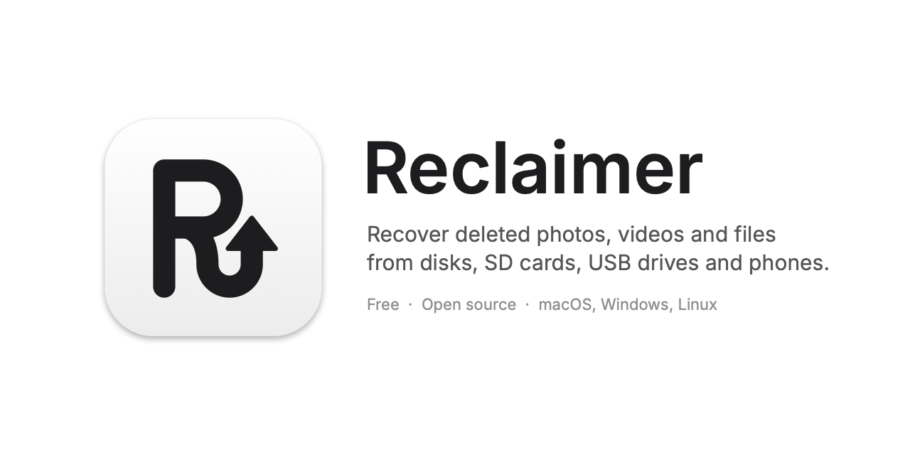
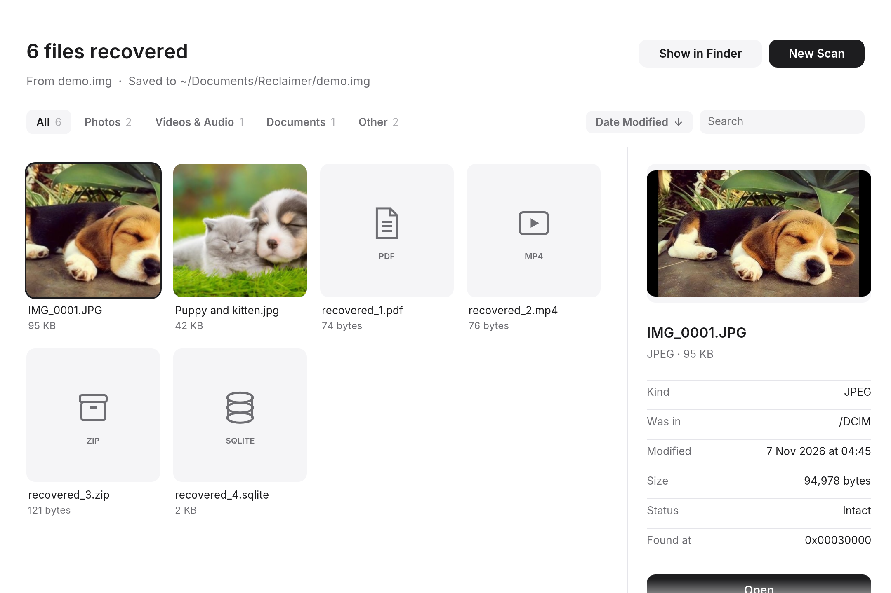
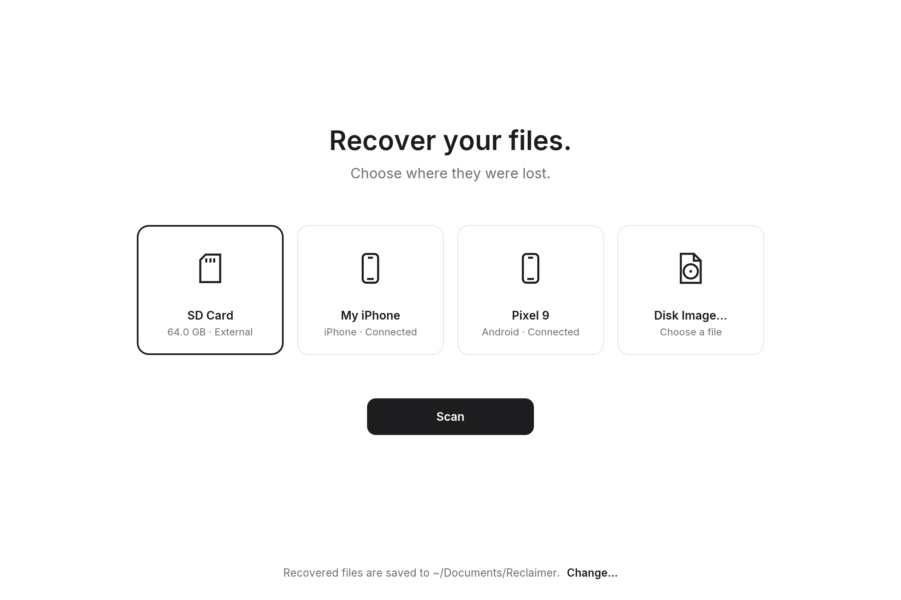

  

  <a href="https://github.com/dincertekin/reclaimer/releases/latest"><picture><source media="(prefers-color-scheme: dark)" srcset="https://raw.githubusercontent.com/dincertekin/dincertekin/main/assets/badges/download-dark.svg"></picture></a>
  <picture><source media="(prefers-color-scheme: dark)" srcset="https://raw.githubusercontent.com/dincertekin/dincertekin/main/assets/badges/macos-windows-linux-dark.svg"></picture>
  <picture><source media="(prefers-color-scheme: dark)" srcset="https://raw.githubusercontent.com/dincertekin/dincertekin/main/assets/badges/rust-dark.svg"></picture>
  <a href="LICENSE"><picture><source media="(prefers-color-scheme: dark)" srcset="https://raw.githubusercontent.com/dincertekin/dincertekin/main/assets/badges/mit-dark.svg"></picture></a>

  <b>Get back the photos, videos and files you deleted.</b> 
  From SD cards, USB flash drives, hard drives and disk images — and from your phone, over a cable.

  <a href="#get-reclaimer">Get Reclaimer</a> ·
  <a href="#what-it-recovers">What it recovers</a> ·
  <a href="#features">Features</a> ·
  <a href="docs/how-it-works.md">How it works</a> ·
  <a href="#questions">Questions</a> ·
  <a href="CONTRIBUTING.md">Contributing</a> ·
  <a href="#would-you-like-to-support-reclaimer">Support</a>

---

Reclaimer is a free, open-source **data recovery app** for macOS, Windows and
Linux. Choose where your files were lost, press **Scan**, and watch them come
back — with their real names, folders and dates whenever the drive still
remembers them.

- **Simple** — one screen to choose, one button to scan. No settings to learn.
- **Thorough** — reads what the file system remembers, then searches every block for what it forgot.
- **Safe** — drives are only ever read, never written. Everything stays on your computer.
- **Native and small** — a 14 MB app written in Rust. No browser engine, no subscription.

## Screenshots

Screenshots use a demo disk image and demo devices.

## Get Reclaimer

| Your computer | Download |
|---------------|----------|
| **Mac** (Apple silicon or Intel) | [Reclaimer-macOS.zip](https://github.com/dincertekin/reclaimer/releases/latest/download/Reclaimer-macOS.zip) — unzip and drag to Applications |
| **Windows** | [Reclaimer-Windows.exe](https://github.com/dincertekin/reclaimer/releases/latest/download/Reclaimer-Windows.exe) |
| **Linux** (Intel or AMD) | [Reclaimer-Linux-x86_64.tar.gz](https://github.com/dincertekin/reclaimer/releases/latest/download/Reclaimer-Linux-x86_64.tar.gz) — unpack and run `./install.sh` |

The apps aren't signed by Apple or Microsoft yet, so the first time:
on a **Mac**, right-click Reclaimer and choose **Open** (or click **Open
Anyway** in System Settings → Privacy & Security); on **Windows**, click
**More info**, then **Run anyway**. All downloads are on the
[releases page](https://github.com/dincertekin/reclaimer/releases/latest).

**Building it yourself:** install [Rust](https://rustup.rs), clone this
repository, and run `cargo run`. [Developing Reclaimer](docs/development.md)
has the details.

**Lost something?** Stop using that card, drive or phone until you've
recovered it. New files can land on the space your deleted ones occupy.

## What it recovers

| From | What comes back |
|------|-----------------|
| **SD cards and USB flash drives** | Deleted and formatted-away photos, videos and documents. Real names and folders on FAT32 and exFAT cards. |
| **Hard drives, SSDs and Windows disks** | Deleted files with names, folders and dates from NTFS and FAT; everything else by searching every block. |
| **Disk images** | `.img`, `.dd`, `.raw`, `.iso`, `.dmg` and other raw images — drag one onto the window. |
| **iPhone, on a cable** | The whole camera roll, including photos in **Recently Deleted**. Unlock it and tap **Trust**. |
| **Android phone, on a cable** | Photos, videos, audio and documents, including the gallery's **trash**. Choose **File Transfer** on the phone. |
| **iPhone backups** | The Camera Roll (with Recently Deleted), Messages attachments and WhatsApp media from Finder or iTunes backups. |

## Features

|                     |                                                                                              |
| ------------------- | -------------------------------------------------------------------------------------------- |
| **Finding files**   | File system recovery for FAT12, FAT16, FAT32, exFAT and NTFS (MBR and GPT partitions), plus carving for JPEG, PNG, GIF, HEIC, AVIF, MP4, MOV, 3GP, PDF, ZIP, DOCX, XLSX, PPTX and SQLite |
| **Real names**      | Original file names, folders and dates whenever the drive remembers them; fragmented files put back together |
| **Phones**          | iPhone and Android over USB, Recently Deleted and gallery trash included; iPhone backups from Finder and iTunes |
| **Results**         | Photo thumbnails (HEIC too), filters for photos, videos and documents, search, sort by date, name, kind or size, and a preview with where each file was |
| **Honest results**  | Each file is marked **Intact** or **Partial**; files you still have aren't shown as "recovered" |
| **Safety**          | Read-only access, bad sectors skipped, never saves onto the drive being scanned, works offline with no tracking |
| **Fast**            | Reads in large chunks, as fast as the drive allows, and lets you stop any time, keeping what it found |
| **Everywhere**      | macOS, Windows and Linux, from one codebase; recovered files go to `~/Documents/Reclaimer` or a folder you choose |

Curious how it all works? Read [How Reclaimer recovers files](docs/how-it-works.md).

## Questions

**Can it recover photos I deleted from my iPhone's Recently Deleted album?**
No — and no other tool can either. iOS gives every file its own encryption
key and destroys it when a file is deleted for good. What Reclaimer *can* do:
recover everything still in Recently Deleted (up to 30 days), and read older
iPhone backups, which may still hold the photo.

**Can it recover files from a formatted SD card or USB stick?**
Often, yes. A quick format only clears the file system's records; the photos
themselves usually stay until they're overwritten. Reclaimer finds them by
searching every block.

**Will scanning damage my drive or overwrite my files?**
No. Reclaimer only reads drives, and it refuses to save recovered files onto
the drive you're scanning.

**Why can't it find files I deleted from my computer's SSD?**
SSDs erase freed space in the background (it's called TRIM), often within
minutes. SD cards, USB sticks and hard drives usually don't, so recovery
there works much better.

**Does it upload my files anywhere?**
No. Reclaimer works entirely offline, has no accounts and collects nothing.

**How is it different from Recuva, PhotoRec or Disk Drill?**
Reclaimer is free and open source, runs natively on macOS, Windows and
Linux, combines file system recovery (real names) with carving (files the
file system forgot) in one app, and also reads phones over a cable.

**My phone or drive doesn't show up. What now?**
For phones: use a data cable (some only charge), unlock the phone, and tap
**Trust** (iPhone) or choose **File Transfer** (Android). If it still doesn't
appear, run `Reclaimer --diagnose` and [open an issue](https://github.com/dincertekin/reclaimer/issues)
with its output. Platform-specific notes are in
[How it works](docs/how-it-works.md#permissions-on-each-platform).

## Roadmap

- Signed and notarized apps, so they open without a warning
- Encrypted iPhone backups
- Very fragmented NTFS files (records that spill into extension records)
- Asking for administrator rights automatically on Windows and Linux

## Contributing

Bug reports, ideas and code are all welcome. Start with
[CONTRIBUTING.md](CONTRIBUTING.md); [Developing Reclaimer](docs/development.md)
covers building, the project structure and the tests. Found a security
issue? Please report it [privately](SECURITY.md).

Built with [Rust](https://www.rust-lang.org) and [egui](https://github.com/emilk/egui).

## Would you like to support Reclaimer?

Reclaimer is free, and it stays free. If it got your files back, you can:

- **[Buy me a coffee](https://buymeacoffee.com/dincertekin)**, or click
  **Sponsor** at the top of the
  [GitHub page](https://github.com/dincertekin/reclaimer): it keeps the work
  going.
- **Give it a star** on GitHub, so more people find it when they need it.
- **Tell a friend** who just lost their photos.

Thank you!

## License

[MIT](LICENSE) © Dinçer Tekin

Reclaimer is for recovering your own files and for legitimate forensic work.
