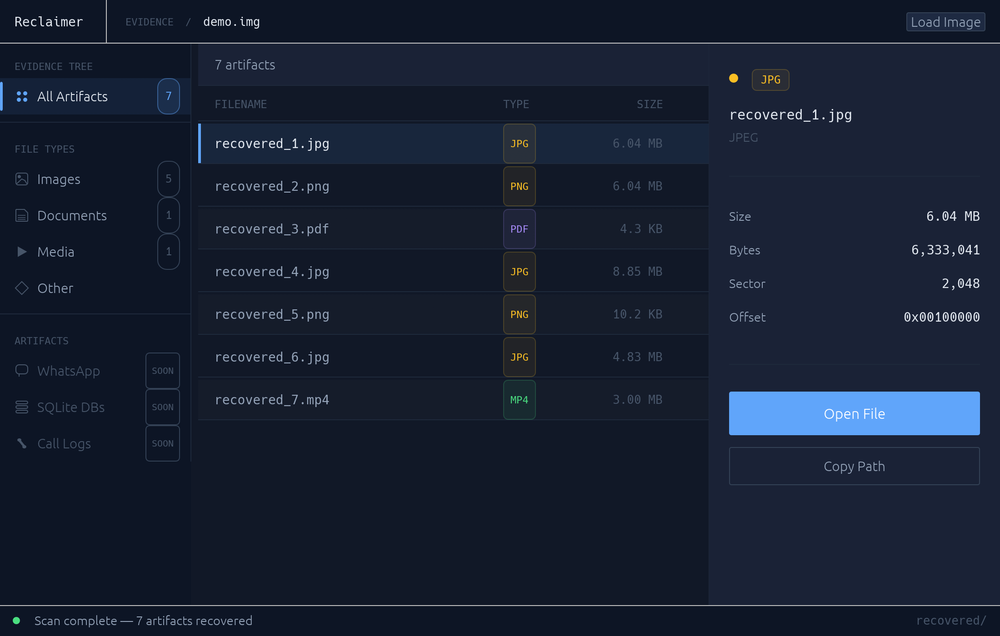

# Reclaimer

A cross-platform file recovery tool written in Rust. Reclaimer scans raw disk images to find and recover deleted files using file signature carving. Built as a hands-on Rust learning project, with a focus on clean code and real forensic techniques.

> Work in progress — recovery works end-to-end on drives and disk images.



<sub>Scan of a demo disk image.</sub>

---

## What Works Right Now

- Scan a physical drive — internal disks, USB sticks, SD cards — on macOS, Windows and Linux
- Or load a `.img`, `.dd`, `.raw`, or any raw disk image via the file picker or drag-and-drop
- Drives are only ever opened read-only; unreadable (bad) sectors are skipped instead of stopping the scan
- iPhone backups (Finder / iTunes): recovers the Camera Roll — including photos in Recently Deleted — plus Messages attachments and WhatsApp media
- Real file names: reads FAT12/16/32, exFAT and NTFS to recover deleted files with their name, original folder and date — fragmented files included
- Fast scanning — reads in large aligned chunks (about 1 GB in under a second from cache)
- Structure-aware carving finds what the filesystem forgot — JPEG (JFIF and EXIF), PNG, GIF, MP4, MOV, HEIC, AVIF, PDF, ZIP, DOCX/XLSX/PPTX, SQLite
- Each file reports whether it was recovered intact or only partially (truncated, or its space since reused)
- Shows only lost files: space that belongs to files you still have is skipped
- A calm, black-on-white interface: choose a drive, press Scan, watch photos appear
- Photo thumbnails, filters (Photos, Videos & Audio, Documents), search, and an inspector with Open / Show in Finder
- Stop a scan at any time and keep what was found so far
- Recovered files go to a folder you choose (default `~/Documents/Reclaimer`), one subfolder per scan
- Refuses to save onto the drive being scanned, since that could overwrite what you want back

---

## How Recovery Works

A scan has two stages.

**1. Ask the filesystem.** Deleting a file rarely erases its record; the filesystem just marks it unused. Reclaimer reads the partition table (MBR or GPT), then each volume's records:

| File system | Where it's used | What a deleted file leaves behind |
|-------------|-----------------|-----------------------------------|
| FAT12 / 16 / 32 | SD cards, USB sticks, cameras | Name (first letter of the short name lost), size, date, first cluster |
| exFAT | Large SD cards, USB drives | Full name, size, date, and whether the data was contiguous |
| NTFS | Windows disks | Full name, folder, dates, and the exact map of every fragment |

Files come back with their real names, saved into their original folders. One whose space has since been reused is marked Partial.

**2. Carve.** Then every block is searched for files the filesystem has forgotten — on a reformatted card, or when a folder's own record was overwritten.

### How carving works

When a file is deleted, the OS marks its sectors as free but rarely overwrites them immediately. Reclaimer reads every sector looking for known **magic bytes** — the fixed byte sequences that start each file type.

Finding the start is easy; finding the **end** is what matters. Reclaimer never guesses: each format's carver walks the file's own structure until it ends.

| Format | Starts with | Ends where |
|--------|-------------|------------|
| JPEG | `FF D8 FF` | `FF D9` reached by hopping segment to segment (skips EXIF thumbnails) |
| PNG | `89 50 4E 47 0D 0A 1A 0A` | after the `IEND` chunk |
| GIF | `GIF87a` / `GIF89a` | the `3B` trailer, after walking all blocks |
| MP4 · MOV · HEIC · AVIF | `ftyp` box at offset 4 | after the last top-level box |
| PDF | `%PDF-` | last `%%EOF` (or the exact length in linearized PDFs) |
| ZIP · DOCX · XLSX · PPTX | `PK 03 04` | end-of-central-directory record that points back to this file |
| SQLite | `SQLite format 3` | page size × page count from the header |

After carving a file, the scan jumps past it rather than re-reading it.

---

## Project Structure

```
src/
├── main.rs              # eframe entry point, loads the Dock icon
├── source/
│   ├── mod.rs           # BlockSource trait, FileSource, Piece + save()
│   ├── window.rs        # read-ahead buffer: few large aligned reads
│   └── drives/          # list and open physical drives: macos.rs, windows.rs, linux.rs
├── fs/                  # deleted files by name: partitions, fat, exfat, ntfs
├── phone/               # iPhone backups (iphone.rs)
├── sqlite.rs            # small read-only SQLite reader (phones keep their indexes in SQLite)
├── scanner/
│   ├── mod.rs           # scan() carves by content
│   └── formats/         # one carver per format; FORMATS table in mod.rs
└── ui/
    ├── mod.rs           # app state, frame loop, actions
    ├── theme.rs         # the design system: colours, type, buttons
    ├── choose.rs        # screen 1: pick a drive or disk image
    ├── results.rs       # screen 2: progress, grid, filters, inspector
    ├── icons.rs         # line icons drawn in code
    ├── thumbs.rs        # background thumbnail decoding with a capped cache
    ├── scan.rs          # background scan thread
    ├── types.rs         # shared types and formatting
    └── tests.rs         # drives the real UI headlessly (egui_kittest)
```

---

## Tech Stack

| Crate | Purpose |
|-------|---------|
| `eframe 0.34` + `egui 0.34` | GUI — immediate-mode, pure Rust, no web tech |
| `rfd 0.15` | Native OS file picker (NSOpenPanel on macOS) |
| `open 5` | Opens recovered files with the OS default app |
| `image 0.25` | App icon and photo thumbnails (PNG, JPEG, GIF) |
| Inter (bundled) | Typeface — [SIL Open Font License](assets/fonts/Inter-LICENSE.txt) |
| `plist`, `libc` (macOS) | Read `diskutil` output; disk ioctls and `authopen` |
| `windows-sys` (Windows) | Drive geometry and model via `DeviceIoControl` |

---

## Getting Started

**Requirements:** Rust (install via [rustup.rs](https://rustup.rs))

```bash
git clone https://github.com/dincertekin/reclaimer
cd reclaimer
cargo run
```

No npm, no build scripts, no extra CLI tools. Plain `cargo run`.

To open a disk image straight away: `cargo run -- path/to/disk.img`.

UI screenshots: `RECLAIMER_SHOTS=/some/dir cargo test scan_an_image` drives the app and saves a PNG per step.

Regenerate the README screenshot with `RECLAIMER_README_SHOT=.github/assets/screenshot.png cargo test readme_screenshot -- --ignored`.

The app icon is drawn in code: `swift icons/make-icon.swift icons` (macOS) regenerates `icon.png`, `icon.icns` and `icon.ico`.

---

## Building the App

| Platform | Command | Result |
|----------|---------|--------|
| macOS | `./packaging/macos/build-app.sh` | `target/release/Reclaimer.app` (about 11 MB) — drag it to Applications |
| Windows | `cargo build --release` | `target\release\Reclaimer.exe`, icon embedded, no console window |
| Linux | `./packaging/linux/install.sh` | Installs to `~/.local` with a menu entry and icon |

The macOS app is signed ad hoc, not notarized: on another Mac, open it the first time with right-click → Open.

---

## Adding a New File Format

Create `src/scanner/formats/<name>.rs` with two functions:

```rust
pub fn matches(header: &[u8]) -> bool                 // does a file start here?
pub fn carve(w: &mut Window, start: u64, limit: u64)
    -> io::Result<Option<Carved>>                     // where does it end?
```

Then add one line to `FORMATS` in `src/scanner/formats/mod.rs`. Use the existing carvers as a guide, and add a `sample()` fixture with tests.

Run the tests with `cargo test`. Filesystem tests use real images made by macOS in `testdata/` (rebuild with `testdata/make-fixtures.sh`), a FAT32 volume written by the `fatfs` crate, and a hand-built NTFS volume. The SQLite reader and iPhone backups are tested on files made by the real SQLite (`testdata/make-sqlite.py`, `testdata/make-iphone-backup.py`). Among other things, they check that the two photos in `test.img` come back byte for byte (by size and checksum).

---

## Roadmap

- [ ] iPhone over USB (no backup needed) and encrypted backups
- [ ] Android over USB — including the gallery's trash
- [ ] HEIC thumbnails in the grid (HEIC photos currently show an icon)
- [ ] NTFS files whose records spill into extension records (very fragmented files)
- [ ] Ask for administrator rights automatically on Windows and Linux (macOS already does)

---

## Reading Drives

| Platform | Drives | Permission |
|----------|--------|------------|
| macOS | `/dev/rdiskN` via `diskutil` | The system password prompt (`authopen`) appears when you scan |
| Windows | `\\.\PhysicalDriveN` | Run Reclaimer as administrator |
| Linux | `/dev/sdX`, `/dev/nvmeXnY`, `/dev/mmcblkN` | Run with `sudo`, or join the `disk` group |

The internal SSD in Apple silicon and T2 Macs is always hardware-encrypted, so raw reads of it return encrypted data. Carving works on external drives, USB sticks, SD cards and disk images.

---

## Phones

| Source | What comes back | Notes |
|--------|-----------------|-------|
| iPhone backup on this computer | Camera Roll (with **Recently Deleted**), Messages attachments, WhatsApp media | macOS: Reclaimer needs **Full Disk Access** to see backups — the Choose screen offers a shortcut. Encrypted backups are listed but can't be read yet. |

Backups are found in `~/Library/Application Support/MobileSync/Backup` (macOS) and `%APPDATA%\Apple Computer\MobileSync\Backup` or `%USERPROFILE%\Apple\MobileSync\Backup` (Windows). A photo deleted from Recently Deleted *before* the backup was made isn't in it.

---

## Supported File Systems

| File System | Status |
|-------------|--------|
| FAT12 / FAT16 / FAT32 | Working — names, folders, dates |
| exFAT | Working — full names, folders, dates, fragmented files |
| NTFS | Working — full names, folders, dates, fragmented and tiny files |
| Anything else (APFS, ext4, …) | Carving only |

Partition tables: MBR (with logical partitions), GPT, or none (cards formatted whole).

---

## Learning Goals

This is a personal Rust learning project. Priorities in order: learning Rust correctly → working features → speed of development. The code is kept in small focused modules, avoids premature abstraction, and comments explain the *why* rather than the *what*.

---

## Disclaimer

Reclaimer is for legitimate data recovery and forensic learning only. Always recover files to a separate drive or folder — never write to the source disk, as that can overwrite the data you are trying to recover.

---

## License

MIT — see [LICENSE](./LICENSE).
